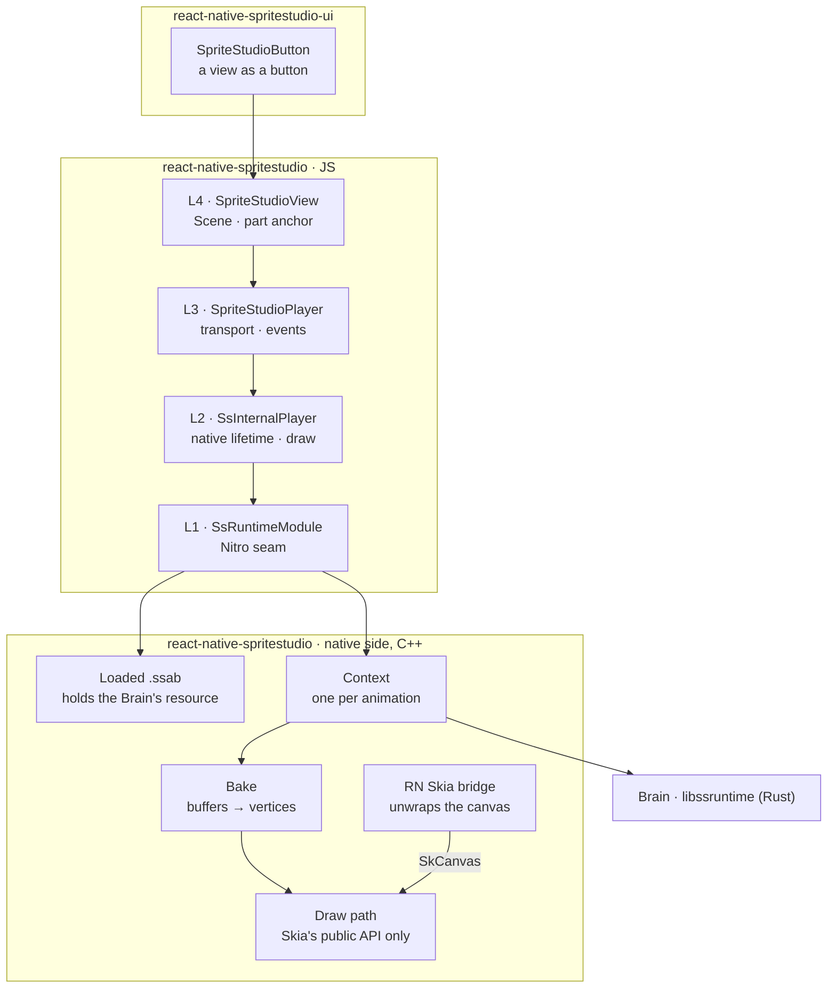

# How the Player Is Put Together

For whoever works on SpriteStudio Player for React Native, or changes it for an app of their own.
It describes the parts by what they do; the [Build Guide](/development/build) gets a checkout
running, uses a changed package in an app and checks it on a simulator or a device, and
[CONTRIBUTING](https://github.com/cri-middleware/SSPlayerForReactNative/blob/HEAD/CONTRIBUTING.md)
has the constraints.

What every SpriteStudio Player shares — how playback, motion blending, sound keys
and part tracking behave — is written once, in the SDK's
[Player Porting Guide](https://github.com/cri-middleware/SpriteStudio-SDK/blob/HEAD/libs/ssruntime/docs/README.md).

## Layers {#layers}

**The Brain** is `libssruntime`, the SpriteStudio-SDK's playback runtime, written in
Rust and kept in the `SpriteStudio-SDK/` submodule: it advances the timeline,
computes every part's pose and hands back each frame as a draw plan. The
`react-native-spritestudio` package turns that plan into Skia draws — four layers in
JS, which the header of its entry point lists top to bottom, over a native side in C++.

An arrow is a call.

| Layer | What it is |
|---|---|
| **L4** | `<SpriteStudioView>` (a Skia canvas, props and a ref), `<SpriteStudioScene>` and `<SpriteStudioSprite>` (one canvas and one clock for many animations), `<SpriteStudioPartAnchor>` and `useSsPartTransform` (following a part) |
| **L3** | `SpriteStudioPlayer`: transport, clock, events; preloading and the leak check |
| **L2** | `SsInternalPlayer`: native lifetime and one draw call per frame; the texture registry and the shared caches. Imports nothing from `react` / `react-native`. |
| **L1** | `SsRuntimeModule`: the Nitro seam onto the Brain, exported raw as the escape hatch. nitrogen generates its bindings from a spec; the C++ behind it is the native side. |

`react-native-spritestudio-ui`'s `<SpriteStudioButton>` is a `<SpriteStudioView>` with a
`<Pressable>` over its box, and it owns the view's playback: the view gets
`playing={false}`, and `SsUiStateDriver` plays, on the view's `SpriteStudioPlayer`, the
section of the label named after each state. When a press is narrowed to some parts,
`hitTestPart` decides it before the `Pressable` sees the touch. The package is released at
the core's version and takes the core as a peer, so an app that only plays animations
installs none of it.

### The native side {#the-native-side}

One autolinked Nitro Hybrid Object makes the rest of the native side: a loaded `.ssab`
and one context per playing animation, which drives the Brain, hands its buffers to JS
and runs the draw. Under the context:

- **The bake** uses neither Nitro nor JSI, so a host tool can run it under ASan.
- **The draw path** never touches RN Skia's JSI object model; the bridge, kept apart
  from it, unwraps the canvas RN Skia hands over.
- **Masks and clipping** are a coverage bitmap. PartColor, the `ss-*` shaders and the
  blend modes, Instance parts and particle effects sit beside them.
- **The tick decision** says whether a player's update can change what it draws, and
  so whether it keeps ticking.
- **A reader of the `.ssab`** takes what rendering needs and the Brain does not hand
  over, and **the asset lookup** finds the app's native asset directory, where a pack
  keeps its layout.

**Around it:** the Expo config plugin ships pack directories as native assets and
narrows the architectures; the Brain and its headers come from `download-sdk` or
`build-runtime` and are not in git; and the host-side checks link the bake, the mask
code and the tick decision against the host Brain (the `check-*` commands on the
[Build Guide](/development/build#checks)).

## Why it is built the way it is {#why-it-is-built-the-way-it-is}

Each reason here spans files; the code it concerns carries the detail in its comments.

**Nothing per vertex crosses JSI.** JS makes the same few calls per player per frame
whatever the vertex count: the context drives the Brain, the bake writes the
vertices in C++, and the draw path draws them into the canvas RN Skia hands over.
Routing vertices through JS was measured and capped the frame rate. That is also
why every buffer handed to JS carries a `generation` and is valid only until the
next `update()`.

**One copy of every native module.** React Native, Nitro Modules, RN Skia and
Reanimated are peer dependencies, and an app that ends up with two copies of one
has two native modules registering the same JSI objects — on iOS, two autolinked
pods. The example app pins the native ones to the exact versions the package
builds against, and pnpm resolves the package's peers to those pins; move them by
hand, together.

**RN Skia is coupled in one place.** The bridge to RN Skia's JSI object model is
kept apart because that model carries no compatibility promise and has broken once;
the draw path uses only Skia's public API. `grep -rl 'RNSkia::' cpp/` lists what an
RN Skia bump can break. The native build defines what RN Skia's own build defines
and does not pass on (`SK_GRAPHITE` among them), in the podspec, in the Android
CMake build and in the host checks.

**Layer 2 stays free of React.** `SsInternalPlayer` and what it uses import nothing
from `react` / `react-native`, so the core runs headless and under
react-native-web; `pnpm run check-layers` holds it to that.

**A pack is a directory, not a file.** Metro ships a dependency graph: `require()`
names one file, and an Android release build flattens and lowercases what it
named, so a `.ssab` could not find its textures beside it. Packs therefore ship as
native assets through the config plugin, and the native side resolves them from the
app's native asset directory.

**The transport is passed through to the Brain.** `SpriteStudioPlayer` holds the
settings it was given only to replay them onto each freshly set-up animation; what
it reports is the Brain's. Setting up an animation resets the loop count, the
section and every override that is not `permanent` in the Brain, and keeps the
speed, the frame-rate override, the frame skip and the direction and style.

**A player that cannot change stops ticking.** The native side asks the Brain whether
a root player's next update can change what it draws — by the character's clock,
not track 0's, since the track stack can keep moving the pose after track 0 ends —
and a player that cannot change stops asking for frames. A copy of that judgement
kept on this side froze poses that should move; `pnpm run check-motion` runs the
decision against the host Brain.
