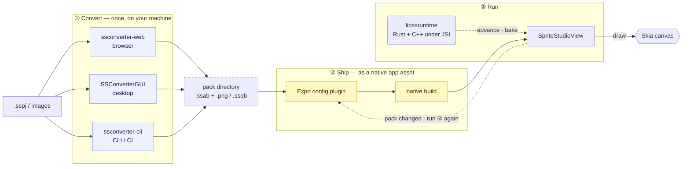

::: warning Not released yet
The npm package is not published, and nothing here has run on a **physical
device** — iOS simulator and Android emulator only. See
[Limitations & Scope](/limitations) for what draws today.
:::

## From `.sspj` to the screen {#pipeline}

Conversion happens **once, at build time**, on your machine. There is no editor
integration and nothing converts at runtime — which makes the middle stage below
the one that is easy to underestimate: a pack is a *directory*, it travels as a
**native app asset**, and changing it means building the app again.

Picking a converter, and what a pack directory has to keep intact, are both in
[Preparing assets](/setup/assets).
