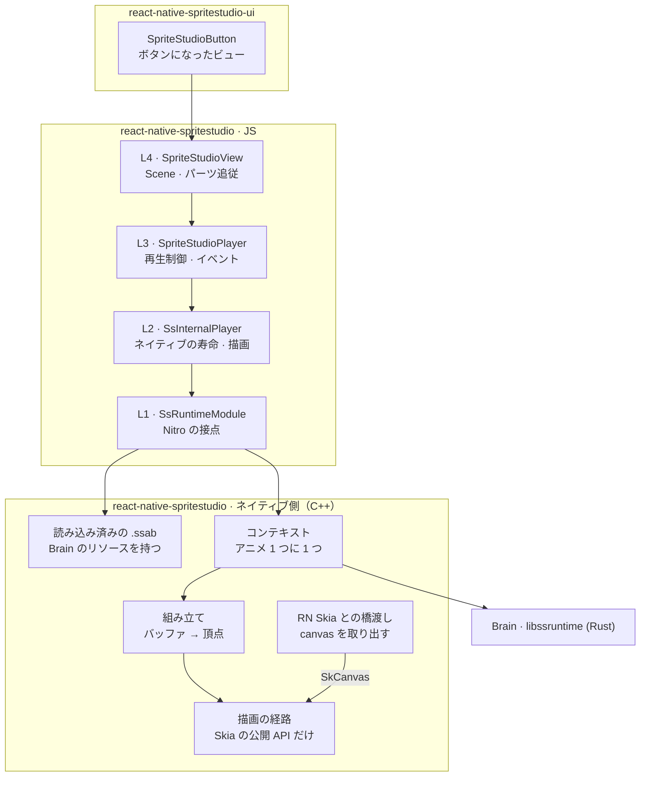

# プレイヤーの構成

SpriteStudio Player for React Native を開発する人と、自分のアプリのために改造する人に向けたページです。部品をその役割で説明します。チェックアウトを動かす手順、変更したパッケージをアプリで使う方法、シミュレータや実機での確かめ方は[ビルドガイド](./build.md)に、制約は [CONTRIBUTING](https://github.com/cri-middleware/SSPlayerForReactNative/blob/HEAD/CONTRIBUTING.md) にあります。

SpriteStudio の Player に共通すること（再生・モーションブレンド・サウンドキー・パーツトラッキングの振る舞い）は、SDK の [Player Porting Guide](https://github.com/cri-middleware/SpriteStudio-SDK/blob/HEAD/libs/ssruntime/docs/README.md) に一度だけ書いてあります。

## 層 {#layers}

**Brain** は SpriteStudio-SDK の再生ランタイム `libssruntime` で、Rust で書かれ、`SpriteStudio-SDK/` サブモジュールにあります。タイムラインを進め、全パーツの姿勢を計算し、各フレームを描画計画として返します。`react-native-spritestudio` パッケージが、その計画を Skia の描画に変えます。JS の 4 つのレイヤー（パッケージの入口の冒頭に上から順に並んでいます）と、その下の C++ のネイティブ側でできています。

矢印は呼び出しです。

| レイヤー | 役割 |
|---|---|
| **L4** | `<SpriteStudioView>`（Skia の canvas、props、ref）、`<SpriteStudioScene>` と `<SpriteStudioSprite>`（多数のアニメに canvas とクロックを 1 つずつ）、`<SpriteStudioPartAnchor>` と `useSsPartTransform`（パーツへの追従） |
| **L3** | `SpriteStudioPlayer`。トランスポート・クロック・イベント、プリロードとリークチェック |
| **L2** | `SsInternalPlayer`。ネイティブの寿命と、1 フレームに 1 回の描画呼び出し。テクスチャレジストリと共有キャッシュ。`react` / `react-native` から何も import しない |
| **L1** | `SsRuntimeModule`。Brain への Nitro の接点で、最後の手段としてそのまま公開している。バインディングは nitrogen が仕様から生成し、その裏の C++ がネイティブ側 |

`react-native-spritestudio-ui` の `<SpriteStudioButton>` は、`<SpriteStudioView>` の表示領域に `<Pressable>` を重ねたもので、ビューの再生を自分で受け持ちます。ビューには `playing={false}` を渡し、`SsUiStateDriver` が、各状態と同じ名前のラベルから始まる区間をビューの `SpriteStudioPlayer` で再生します。押せる範囲を一部のパーツに絞ったときは、`Pressable` がタッチを受け取る前に `hitTestPart` で判定します。このパッケージはコアと同じ版で出し、コアを peer として受け取るので、アニメを再生するだけのアプリには入りません。

### ネイティブ側 {#the-native-side}

自動リンクされる Nitro の Hybrid Object が 1 つあり、それがネイティブ側のほかのすべてを作ります。読み込み済みの `.ssab` と、再生中のアニメ 1 つごとのコンテキストです。コンテキストは Brain を動かし、そのバッファを JS に渡し、描画を実行します。コンテキストの下には次のものがあります。

- **組み立て**は Nitro にも JSI にも依存しないので、ホストのツールが ASan の下で動かせます。
- **描画の経路**は RN Skia の JSI オブジェクトモデルに触れません。そこから切り離した橋渡しが、RN Skia が渡す canvas を取り出します。
- **マスクとクリッピング**はカバレッジのビットマップです。PartColor、`ss-*` シェーダー、ブレンドモード、インスタンスパーツ、パーティクルエフェクトがその横にあります。
- **tick の判断**は、プレイヤーの更新が描くものを変えうるか、つまり tick を続けるかを決めます。
- **`.ssab` の読み取り**は、描画に要るのに Brain が渡さないものを読みます。**アセットの探索**は、パックが変換時の配置を保つ、アプリのネイティブアセットのディレクトリを見つけます。

**周辺:** Expo の config plugin が、パックのディレクトリをネイティブアセットとして同梱し、アーキテクチャを絞ります。Brain とそのヘッダーは `download-sdk` か `build-runtime` が置くもので、git には無いものです。ホスト側のチェックは、組み立て・マスク・tick の判断をホストの Brain とリンクして確かめます（[ビルドガイド](./build.md#checks)の `check-*` コマンド）。

## この作りになっている理由 {#why-it-is-built-the-way-it-is}

ここに挙げる理由はどれも複数のファイルにまたがります。詳細は、関わるコードのコメントにあります。

**頂点ごとのものは JSI を越えません。** JS が呼ぶのは、頂点数に関係なく、プレイヤーごと・フレームごとに同じ数回だけです。コンテキストが Brain を動かし、組み立てが C++ で頂点を書き、描画の経路が RN Skia から渡された canvas に描きます。頂点を JS に通す方法は計測して、フレームレートの頭打ちになると分かりました。

**ネイティブモジュールはどれも 1 つだけにします。** React Native・Nitro Modules・RN Skia・Reanimated は peer dependency で、アプリにどれかが 2 つ入ると、同じ JSI オブジェクトを 2 つのネイティブモジュールが登録することになります（iOS では、自動リンクされた 2 つの pod）。サンプルアプリは React・React Native・RN Skia・Reanimated・Worklets を、パッケージがビルドされる版に完全一致で固定し、Nitro Modules はキャレット指定にしています。pnpm がパッケージの peer をそれらに解決します。固定したものは、上げるときに手で、まとめて上げてください。

**RN Skia との結び付きは 1 か所に閉じ込めます。** RN Skia の JSI オブジェクトモデルへの橋渡しを切り離しているのは、そのモデルに互換性の約束が無く、一度壊れたことがあるからです。描画の経路が使うのは Skia の公開 API だけです。RN Skia を上げたときに壊れうるものは `grep -rl 'RNSkia::' packages/react-native-spritestudio/cpp/` で並びます。RN Skia が自分のビルドにだけ付けて利用側に伝えない定義（`SK_GRAPHITE` など）は、podspec・Android の CMake のビルド・ホストのチェックでこちらでも付けています。

**レイヤー 2 は React に依存しません。** `SsInternalPlayer` とそれが使うものは `react` / `react-native` から何も import しないので、コアはヘッドレスでも使え、react-native-web への道も残ります。`pnpm run check-layers` がそれを守ります。

**パックはファイルではなくディレクトリです。** Metro が配るのは依存のグラフです。`require()` は 1 つのファイルを名指し、Android のリリースビルドは名指されたものを平らにして小文字にするので、`.ssab` は横にあるテクスチャを見つけられません。そのためパックは config plugin でネイティブアセットとして同梱し、ネイティブ側がアプリのネイティブアセットのディレクトリから解決します。

**トランスポートは Brain にそのまま渡します。** `SpriteStudioPlayer` が設定を持つのは、新しく設定したアニメに再適用するためだけです。報告する値は Brain のものです。アニメを設定すると、Brain ではループ回数・再生区間・`permanent` ではないオーバーライドがリセットされ、速度・フレームレートの上書き・フレームスキップ・方向とスタイルは保たれます。

**変わりようのないプレイヤーは tick を止めます。** ネイティブ側は、ルートのプレイヤーの次の更新が描くものを変えうるかを Brain に尋ねます。見るのはトラック 0 ではなくキャラクターのクロックです。トラック 0 が終わっても、トラックのスタックが姿勢を動かし続けることがあるためです。変わりようのないプレイヤーはフレームを求めなくなります。この判断をこちら側で写しておいた版は、動くはずの姿勢を止めてしまいました。`pnpm run check-motion` が、この判断をホストの Brain で確かめます。

**イベントの読み取りは取り出しではありません。** ランタイムは収集のたびにイベントのリストを組み直すので、1 ティック中に 2 回読んでも同じイベントが返り、一度も読まなくても何も失われません。毎フレームの読み取りはハンドラの prop の有無で制御しているので、ハンドラの無いビューはその分を払いません。

**`playing` prop の写像はコンポーネントで行います。** boolean の prop が存在することを知っている唯一の層なので、`false` を `pause()` に、`true` を `resume()` か `play()` に変えます。プレイヤーは 4 つの動詞を分けたまま持ちます。

**色の文字列と名前のハッシュは実装を 1 つにします。** `color` を解釈するのは `Skia.Color` で、名前はすべて `SsRuntimeModule.hashString`（Rust コアがキーを作るのと同じ FNV-1a）でハッシュします。共通の概念に対する 2 つ目の実装は、整合を保てる数より 1 つ多いからです。

**`ssPreload` はプレイヤーを丸ごと読み込みます。** テクスチャの一覧はコンテキストが `.ssab` から読み出すもので、コンテキストとはプレイヤーのことなので、1 つ読み込んで捨てるより短い経路はありません。残るのはキャッシュのエントリです。

**フレームループは JS スレッドに置いています。** UI スレッドへ移すには update → bake → draw の連鎖全体が worklet ランタイムから届く必要があり、update と draw を別のスレッドに分けることはできないので、段階的にではなく一度に移す作業です。

**peer の下限。** React Native Skia 3 は Skia Graphite で描画し、ネイティブのビルドはそのヘッダーに、React Native Skia 自身のビルドと同じ define でコンパイルします。`react-native-nitro-modules` の 0.37 は、`nitrogen/` の生成済みバインディングと対応します。

**`ss-*` シェーダーは Normal パーツ向けです。** シェーダーの計算は、アフィン変換された 1 枚の四角形を前提にしていて、Mesh・Shape・Effect はそうではありません。
