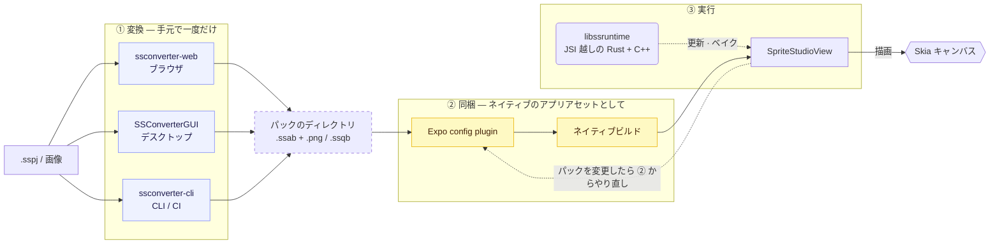

::: warning まだリリースされていません
npm パッケージは未公開で、**実機での動作確認もまだありません** — iOS シミュレータと
Android エミュレータのみです。現時点で何が描けるかは
[制約と適用範囲](/ja/limitations)を参照してください。
:::

## `.sspj` から画面まで {#pipeline}

変換は**ビルド時に一度だけ**、手元のマシンで行います。エディタ連携はなく、実行時に
変換されるものもありません。そのぶん見落とされやすいのが下図の中段です。パックは
*ディレクトリ*で、**ネイティブのアプリアセット**として運ばれ、変更するたびにアプリの
ビルドが必要になります。

コンバータの選び方と、パックのディレクトリが保たなければならないものは
[アセットの準備](/ja/setup/assets)にあります。
