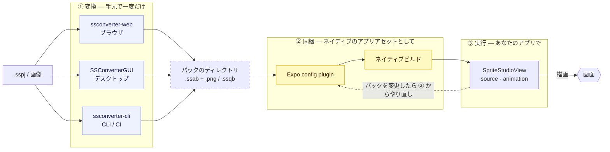

# アセットの準備（`.sspj` → `.ssab`）

SpriteStudio 7 が保存するのは `.sspj` プロジェクトで、このパッケージが再生するのは
`.ssab` です。その間の変換は**あなた自身が**手元のマシンで、**ビルド時に一度だけ**実行
する手順です。React Native にはインポータを載せるエディタが無いので、エンジン系の
プレイヤーと違って自動の経路はなく、実行時に変換されるものもありません。変換はあなたが
持つ手順です。



見落とされやすいのは中段で、このページの残りはその中段の詳細です。パックは*ディレクトリ*
で、**ネイティブのアプリアセット**として運ばれ、変更するたびにアプリのビルドが必要に
なります。

## コンバータを選ぶ

ツールは 3 つ、背後のコンバータは 1 つです。能力ではなく**作業スタイル**で選んでください
— 出力は同じです。

| ツール | 向いている場面 | 入手方法 |
|---|---|---|
| `ssconverter-web` | 数個を手作業で変換。インストール不要 | <a href="https://cri-middleware.github.io/SSPlayerForWeb/ssconverter/" target="_blank" rel="noreferrer">ホスト版のコンバータ</a>を開く |
| SSConverterGUI | デスクトップ GUI で繰り返し変換 | [Releases](https://github.com/cri-middleware/SSConverterGUI/releases) のバイナリ |
| `ssconverter-cli` | CI、バッチ、再現性 | [SpriteStudio-SDK の Releases](https://github.com/cri-middleware/SpriteStudio-SDK/releases) のバイナリ |

::: warning `ssconverter-web` には Chromium 系ブラウザが必要です
フォルダ選択に **File System Access API** を使うため、Chrome や Edge では動作し、
Firefox と Safari では動作しません。パックは出口だけでなく、入口でもディレクトリです。
:::

::: tip 変換そのものは、全プレイヤー共通で 1 か所に書かれています
[スタンドアロンツールでの変換](https://cri-middleware.github.io/SpriteStudio-Docs/ja/overview/convert-with-a-standalone-tool/)
がこのパッケージの取る経路で、ツールの選び方とビルドや CI パイプラインへの組み込みを
扱っています。[アセットの変換](https://cri-middleware.github.io/SpriteStudio-Docs/ja/overview/conversion/)
は全体像です — 一部のエンジンが取り込み時に変換し、これがそうしない理由も含みます。
:::

## パックはファイルではなくディレクトリです

`.ssab` は、テクスチャ、Instance パーツが参照する外部パック、そして `.ssqb` を通じて
シーケンスするパックを、**すべて自身からの相対パス**で指定します。したがってコンバータの
*出力ディレクトリ*がそのまま端末に届く必要があります。

Metro はこれを運べません。`require()` が名指ししたものだけをバンドルし、ディレクトリを
走査することはなく、さらに Android のパッケージャが名指しされたものを `res/` に平坦化
してしまいます。ここから 2 つの帰結が出てきますが、どちらも重要です。

- **`require()` したモジュールは `source` として使えません。** 背後にディレクトリを
  持たない唯一の形式です。
- **`assetExts` に `ssab` / `ssqb` を入れてはいけません。** Metro にこれらの拡張子を
  教えると、まさに動作しない「平坦化され、兄弟ファイルを失ったコピー」ができあがります。

パックのディレクトリは代わりに**ネイティブのアプリアセット**として同梱します。

```json
{
  "expo": {
    "plugins": [["react-native-spritestudio", { "assets": ["./assets/ss"] }]]
  }
}
```

プラグインはビルドのたびに再コピーするので、コンバータを再実行した後はリビルドだけで
済み、`prebuild` のやり直しは不要です。

::: warning アセットは Fast Refresh されません
パックを変更したらネイティブビルドが必要です。回避策はありません。このファイルは
バンドルのエントリではなくアプリのアセットだからです。
:::

## Reference パックと Embedded パック {#reference-and-embedded-packs}

コンバータは 2 種類のどちらかを出力します。これは SDK 側の呼称です。
`ssconverter-cli --embedded` は Embedded パックを、フラグなしなら Reference パックを
生成します。

| 種類 | 同梱される形 | トレードオフ |
|---|---|---|
| **Reference** | `.ssab` と、その隣に並ぶ `.png` 群 | テクスチャごとに 1 ファイル。同じセルマップを名指しするパック間で共有されます |
| **Embedded** | 自己完結した `.ssab` 1 つ | 運搬中に失うものがない。エンコードされたバイト列はリソースの生存期間中ずっと常駐します |

どちらもここで動作します。ローダーはテクスチャ単位で選択し Embedded を優先するので、
両方が混在したパックでも問題ありません。
