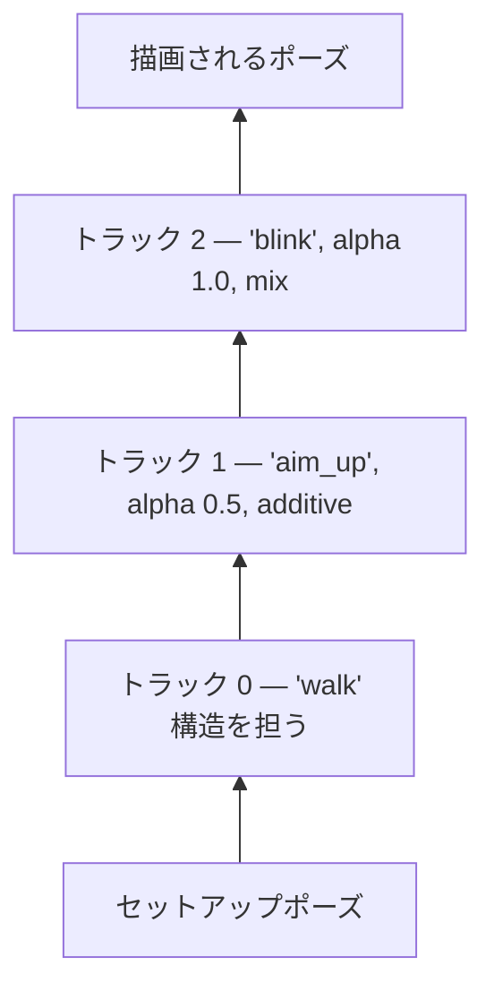

# モーションブレンディング

1 体のキャラクターで複数のアニメーションを同時に再生し、カットせずに移り変わります。下地に歩行、その上に照準のオーバーレイ、さらにワンショットのリアクションをクロスフェードで — すべてアーティストが別々にオーサリングしたファイルからです。

## prop でクロスフェードする

よくある使い方にはコードが要りません。ビューに `transitionMs` を渡すと、`animation` を変えたときにカットではなくクロスフェードになります。

```tsx
<SpriteStudioView
  source={SsAssets['Ringo/Ringo']}
  animation={state === 'moving' ? 'walk' : 'wait1'}
  transitionMs={250}
/>
```

`transitionMs` が `0`（既定）なら、これまでどおり新しいアニメーションをそのままセットアップして、頭から再生します。ロードの最初のアニメーションは常にそのままセットアップします — フェード元になる絵がまだ画面に無いからです。

::: warning トラック 0 の切り替えは 1 つの経路で
`animation` でトラック 0 を動かしているときは、プレイヤーの `crossfade(0, …)`・`setTrackAnimation(0, …)`・`setAnimation` ではなく、prop で切り替えてください。prop が働くのは値が**変わったとき**だけなので、prop の知らないところで切り替えた後に元の名前を書いても、何も起きません。トラック 1 以降はプレイヤーだけのものです。
:::

このページのほかの操作は、すべてプレイヤーから行います — ビューの ref の `player`、`onLoad` が渡すプレイヤー、またはシーンで自分が持つプレイヤーです。

## モデル：トラックのスタック

トラックは**セットアップポーズ**の上に、昇順に折り重なります。各トラックはアニメーション・**アルファ**（下のポーズに対してどれだけ残るか）・**ブレンドモード**を持ちます。



**トラック 0 は特別です。** `setAnimation` が載せるのがこれで、プレイヤーが報告するのもトラック 0 のアニメーションです。`currentAnimation`・`isPlaying`・`isFinished`・`justLooped`・フレーム・イベント・キャンバスは、すべてこれに従います。その上のトラックはオーバーレイです。

| ブレンドモード | 内容 |
|---|---|
| `SsTrackBlend.mix` | そのトラックのポーズへ線形補間します。alpha 1 で完全に上書き |
| `SsTrackBlend.additive` | **セットアップポーズからの差分**を加算するので、下のものが透けて残ります。照準・傾き・呼吸のためのモード |

## オーバーレイを載せる

```ts
import { SsTrackBlend } from 'react-native-spritestudio'

player.setTrackAnimation(1, 'aim_up') // オーバーレイ
player.setTrackBlend(1, SsTrackBlend.additive)
player.setTrackAlpha(1, 0.5) // 半分の強さ

// ... 外すとき
player.clearTrack(1)
```

`clearTrack` はトラック 0 を拒否します。代わりに alpha 0 へフェードしてください。キャラクターがセットアップポーズへ収まります。

::: warning `setAnimation` はスタックをたたみます
アニメーションをそのまま選ぶとトラック 0 に載り、ほかのトラック（オーバーレイ・フェード・その設定）は一緒に消えます。その後でオーバーレイを載せ直してください。トラック 0 のクロスフェードでは消えません。
:::

## カットではなくフェードする

フェードは再生の時計で進みます。開始したら、あとは描き続けるだけです。一時停止中や停止中のプレイヤーでは、フェードも待ちます。

```ts
// トラックの再生内容を、いまの状態から 400 ms かけて差し替える。
player.crossfade(0, 'run', 400)

// トラックの alpha を 250 ms かけて動かす。
player.fadeTrack(1, 0, 250) // オーバーレイを抜く
player.fadeTrack(0, 0, 600) // キャラクター全体をセットアップポーズへ収める

player.trackFadeProgress(0) // 0〜1。フェードしていなければ null
player.cancelTrackFade(1)
```

### トラック 0 のクロスフェードで何が、いつ替わるか

入ってくるアニメーションは、フェードが終わったときではなく、**フェードを始めたとき**にトラック 0 を引き継ぎます：

* 呼んだ直後から `currentAnimation` は入ってくる側の名前を返します。そのため、フェードで出ていった名前で `setAnimation` を呼ぶと、何もしないのではなく、そちらへ戻ります。`onAnimationChanged` は発火し、`onAnimationStarted` は発火しません — 再生を続けたままの切り替えは `play()` ではないからです。キャンバスもこれに従います。
* セルや表示・非表示など、ブレンドできない値は、フェードの最初のフレームから入ってくる側のものになります。`isFinished` と `onAnimationFinished` が報告するのも入ってくる側の再生状態です。フェード中に出ていく側が終わっても、プレイヤーは終了になりません。
* イベントはフェードの開始から入ってくる側のものが発火し、出ていく側は止まります（[イベント](#events)を参照）。
* 入ってくる側は、`setAnimation` で切り替えたときと同じく、設定した再生制御（速度・フレームレート・フレームスキップ・方向・ループ回数）で、全体の先頭から再生されます。

トラックで再生していたものは、比率を保ったまままとめてフェードアウトします。フェード中にもう一度 `crossfade` すると、進行中のフェードをその時点の状態のまま引き取るので、姿勢は飛びません。`cancelTrackFade` の後や、複数のアニメーションを混ぜているトラックからの `crossfade` でも同じです。

`frameScope="animation"` で計測した枠は、クロスフェードでは計測し直しません。計測はアニメーションをセットアップし直すので、スタックがたたまれてしまうからです。

## 1 つのトラックで 2 つのアニメーションを混ぜる

1 つのトラックには、複数のアニメーションを載せて **weight** で混ぜられます。キャラクターの移動速度に応じて歩きと走りを混ぜる、といった使い方です。載せた 1 つ 1 つを*ソース*と呼び、ハンドルで指定します：

```ts
const walk = player.trackMainSource(0)!
const run = player.addTrackSource(0, 'run', 0)! // 歩きの横に、いまは無音で載せる

// 毎フレーム、キャラクターの速度から
player.setSourceWeight(walk, 1 - t)
player.setSourceWeight(run, t)
```

* weight は**トラックの中での比率**です。`(0.7, 0.3)` と `(7, 3)` は同じ混ざり方になります。トラックの強さは、引き続き alpha で決めます。
* 尺の違う歩きと走りは、だんだんずれていきます。トラックの同期を `SsTrackSync.start` にしてから走りを載せる（下の節）と、歩調をそろえて始められます。または `setSourceFrame` でシークしてください。
* ハンドルは、そのソースが解放されるまで有効です。解放されるのは、クロスフェードの完了、`clearTrack`、`setAnimation` のときです。ハンドルの番号は使い回されるので、持ち続けずに `trackMainSource` で読み直してください。

## トラック 0 と歩調をそろえて始める

トラックに載せたアニメーションは、再生区間の先頭から始まります。歩幅の途中にいる歩きの上に走りを載せると、足の運びが食い違います。トラックの**同期**を `SsTrackSync.start` にすると、そのあと載せたアニメーションは、トラック 0 がいる**位相**から始まります。位相とは、再生区間のどこまで進んだかを、先頭を 0、終端に向かって 1 とした割合で表したものです。尺の違うアニメーションも、割合でそろいます：

```ts
import { SsTrackSync } from 'react-native-spritestudio'

player.setTrackSync(0, SsTrackSync.start) // 載せる前に設定する
player.crossfade(0, 'run', 400) // 走りは歩きと同じ位相から始まる
```

| 同期 | 載せたアニメーションの開始位置 | 向いている使い方 |
|---|---|---|
| `SsTrackSync.free`（既定） | 再生区間の先頭 | 一回きりの動き（まばたき、口の形、被弾リアクションなど） |
| `SsTrackSync.start` | トラック 0 のアニメーションと同じ、再生区間の中の割合の位置 | 周期的な動きどうしを重ねる（歩きと走りなど） |

そろえるのは、アニメーションを載せたときの**1 回だけ**です。alpha や blend と同じくトラックの設定で、`setAnimation` で元に戻ります。

## トラックの再生設定

速度・フレームレートの上書き・フレームスキップ・方向は、そこに載っているアニメーションではなく**トラック**の設定です。そのトラックのすべてのアニメーション（クロスフェード中なら両側）と、あとから載せるすべてのアニメーションに効きます。

```ts
player.setTrackSpeed(1, 0.5)
player.setTrackFrameRate(1, 24)
player.setTrackFrameSkipEnabled(1, false)
player.setTrackPlaybackDirection(1, SsPlaybackDirection.forward, SsPlaybackStyle.pingPong)
```

トラック 0 の設定は、再生制御そのものです（`setSpeedScale` がトラック 0 の `setTrackSpeed`、ほかも同様）。どちらの名前で設定しても同じ値になり、プレイヤーはロードし直しても保ちます。**ループ回数**だけはトラックではなくアニメーションの設定です。アニメーションを載せると無限ループに戻るので、載せた後で指定し、トラックが終わるのを見張ります。トラック 0 のループ回数は `setLoopCount`（または `setTrackLoopCount(0, …)`）で、プレイヤーはトラック 0 が切り替わるたびにその値をかけ直します。

```ts
player.setTrackAnimation(2, 'hit_react')
player.setTrackLoopCount(2, 1) // 1 回再生して、最後のフレームで止まる

// 毎フレーム
if (player.isTrackFinished(2)) {
  player.fadeTrack(2, 0, 120) // 終わったトラックは、何かするまで最後のフレームのまま
}
```

`trackJustLooped(track)` は tick ごとのパルスで、トラック 0 の `justLooped` にあたります。どちらも、走らなかった tick の後は false を返します。トラック 1 以降の終了やループでコールバックは発火しません。`onAnimationFinished` になるのは、トラック 0 の終了だけです。トラック 0 が終わっても、ほかのトラックやフェードが動いているあいだは、プレイヤーは tick を続けます。

## トラックをスクラブする

制御軸そのものをアニメーションとしてオーサリングし（頭が左端から右端まで振り向く、まぶたが開く）、それを*再生しません*。追従したい値で**スクラブ**します：

```ts
player.setTrackAnimation(1, 'look_lr')
player.setTrackBlend(1, SsTrackBlend.additive)
player.setTrackSpeed(1, 0) // 自動では進まない
player.setTrackFrame(1, headYawFrame) // ... あなたが動かす
```

## イベント {#events}

既定でイベントを発火するのは、トラック 0 の主ソースだけです。どのイベントも、発火したソースを `source` に持ちます。`trackMainSource` や `addTrackSource` が返すのと同じハンドルです。

* ほかのソースのイベントも受け取るには、`setSourceEventThreshold` でしきい値をそのソースの weight 以下に下げます。
* **クロスフェードの出ていく側は、フェードの開始と同時に発火しなくなります** — ちょうど入ってくる側が発火を始める時点です。`setTrackOutgoingEventThreshold(track, 0.5)` にすると、フェードの前半のあいだは発火し続けます。イベントを数えている場合は、この設定で数が変わります。

## 読み出しと、断られた操作

読み出しは、報告するものが無いときに `null` を返します — トラックが 2 本のプレイヤーでの `trackAlpha(3)` や、フェードしていないときの `trackFadeProgress(0)` などです。トラックが何本あるかは `trackCount` で分かります。

何もしなかった操作は `false`（`addTrackSource` は `null`）を返し、理由をコンソールに出します。呼び出しと対象ごとに 1 回だけなので、ステートマシンが毎フレーム同じ操作を繰り返しても 1 行で済みます。

## 2 つの制限 {#two-limits}

* **インスタンスとエフェクトの子はレイヤー化されません。** 別のアニメーションを再生するパーツは自分の再生で動き、ルートが組み立てたフレームから駆動されます。トラック 0 のクロスフェードをまたいで、そうした子をどのキーで動かすかも対象外です。
* トラックの **alpha** が強さです。1 つのトラックを複数のアニメーションが共有する場合、ソースの *weight* はそれらの比率を決めるだけで、2 つ目の音量つまみではありません。

## 実際に見る

サンプルアプリの **Blending** タブで、ここに書いたことを手で動かせます。トラック 0 のクロスフェードとカット、トラック 1 のオーバーレイ（alpha・ブレンド・ループ回数）、トラック 0 の速度とループ回数、両方のトラックの同期、出ていく側が発火するかどうかです。状態の表示には、トラック 0 のアニメーション（クロスフェードを始めた瞬間に替わる）と、直近のイベント（発火したソース付き）が出ます。
