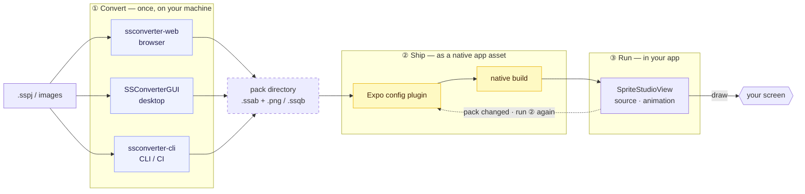

# Preparing assets (`.sspj` → `.ssab`)

SpriteStudio saves a `.sspj` project; what this package plays is a `.ssab`.
Converting between them is a step **you** run, on your own machine, **once at
build time**. React Native has no editor to host an importer in, so unlike the
engine players there is no automatic path and nothing converts at runtime — the
conversion is a step you own.



The middle stage is the one that is easy to underestimate, and the rest of this
page is that stage in detail: a pack is a *directory*, it travels as a **native
app asset**, and changing it means building the app again.

## Choosing a converter

Three tools, one converter behind them. Pick by how you work rather than by
capability — the output is the same.

::: tip No `.sspj` of your own yet?
The [official SpriteStudio sample data](https://www.webtech.co.jp/help/ja/spritestudio7/download/sample/)
works as-is — that page is only available in Japanese, but the downloads
themselves are language-neutral. [Ringo](https://www.webtech.co.jp/help/ja/spritestudio7/download/sample/#ringo)
is a good character sample, and
[Particle](https://www.webtech.co.jp/help/ja/spritestudio7/download/sample/#Perticle_sample) is a good
one if you want effects. The downloaded project feeds any of the converters
below as-is.
:::

| Tool | Best for | Getting it |
|---|---|---|
| `ssconverter-web` | converting a few projects by hand, nothing installed | open <a href="https://cri-middleware.github.io/SSPlayerForWeb/ssconverter/" target="_blank" rel="noreferrer">the hosted converter</a> |
| SSConverterGUI | a desktop GUI, used repeatedly | a binary from [its Releases](https://github.com/cri-middleware/SSConverterGUI/releases) |
| `ssconverter-cli` | CI, batch, reproducibility | a binary from the [SpriteStudio-SDK Releases](https://github.com/cri-middleware/SpriteStudio-SDK/releases) |

::: warning `ssconverter-web` needs a Chromium browser
It picks a folder through the **File System Access API**, so Chrome or Edge
works and Firefox and Safari do not. A pack is a directory on the way in as well
as on the way out.
:::

::: tip The conversion itself is documented once, for every player
[Converting with a standalone tool](https://cri-middleware.github.io/SpriteStudio-Docs/overview/convert-with-a-standalone-tool/)
is the path this package takes, and covers picking a tool and wiring it into a
build or CI pipeline. [Converting assets](https://cri-middleware.github.io/SpriteStudio-Docs/overview/conversion/) is the
overview — including why some engines convert on import and this one does not.
:::

## A pack is a directory, not a file

A `.ssab` names its textures, the external packs its Instance parts reach, and —
through a `.ssqb` — the packs it sequences, **all by paths relative to itself**.
So the converter's *output directory* is what has to reach the device intact.

Metro cannot carry one. It bundles what a `require()` names and never walks a
directory, and Android's packager then flattens what it did name into `res/`.
Two consequences follow, and both are load-bearing:

- **A `require()`d module is not a valid `source`.** It is the one form with no
  directory behind it.
- **`assetExts` must stay clean of `ssab` / `ssqb`.** Teaching Metro about them
  would produce exactly the flattened, sibling-less copy that cannot work.

Pack directories ship as **native app assets** instead:

```json
{
  "expo": {
    "plugins": [["react-native-spritestudio", { "assets": ["./assets/ss"] }]]
  }
}
```

The plugin re-copies on every build, so re-running the converter needs only a
rebuild — not a fresh `prebuild`.

::: warning Assets do not Fast Refresh
Changing a pack means a native build. There is no way around it: the file is an
app asset, not a bundle entry.
:::

## Reference and Embedded packs

The converter emits one of two kinds, and these are the SDK's names for them.
`ssconverter-cli --embedded` produces an Embedded pack; without the flag you get
a Reference one.

| Kind | Ships as | Trade |
|---|---|---|
| **Reference** | the `.ssab` plus its `.png` files beside it | one file per texture, shared between packs naming the same cellmap |
| **Embedded** | one self-contained `.ssab` | nothing to lose in transit; the encoded bytes stay resident for the life of the resource |

Both work here. The loader picks per texture, with Embedded winning, so a pack
that mixes the two is fine.
