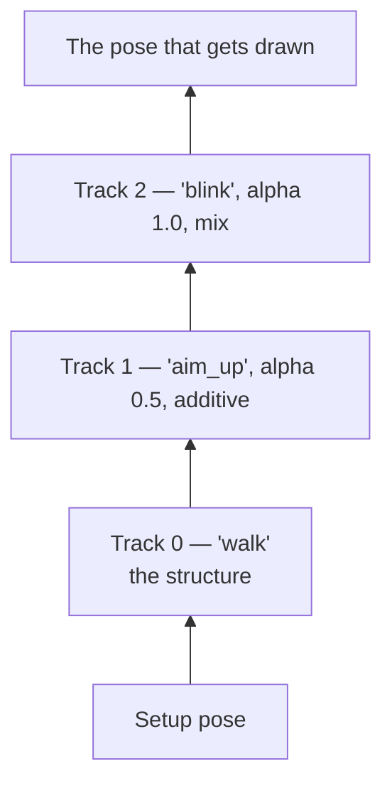

# Motion blending

Play several animations on one character at once, and move between them without a cut. A walk
underneath, an aim overlay on top, a one-shot reaction crossfading in — from files an animator
authored separately.

## Crossfading with a prop

The common case needs no code: give the view `transitionMs`, and a change of `animation`
crossfades instead of cutting.

```tsx
<SpriteStudioView
  source={SsAssets['Ringo/Ringo']}
  animation={state === 'moving' ? 'walk' : 'wait1'}
  transitionMs={250}
/>
```

With `transitionMs` at `0` (the default) a change sets the new animation up outright and heads
out into it. The first animation of a load is always set up outright — there is
nothing on screen yet to fade from.

::: warning Switch track 0 through one route
With `animation` driving track 0, switch it through the prop and not through the player's
`crossfade(0, …)`, `setTrackAnimation(0, …)` or `setAnimation`. The prop acts only when it
**changes**, so after a switch behind its back, writing the old name again does nothing. The
tracks above 0 are the player's alone.
:::

Everything else on this page goes through the player — the `player` of the view's ref, the one
`onLoad` hands over, or one you own on a scene.

## The model: a stack of tracks

Tracks fold onto the **setup pose** in ascending order. Each track has an animation, an **alpha**
(how much of it survives onto the pose below) and a **blend mode**.



**Track 0 is special.** It is what `setAnimation` lays, and its animation is the one the player
reports: `currentAnimation`, `isPlaying`, `isFinished`, `justLooped`, the frame, the events and
the canvas all follow it. The tracks above it are overlays.

| Blend mode | What it does |
|---|---|
| `SsTrackBlend.mix` | Lerps toward the track's pose. At alpha 1 the track wins outright |
| `SsTrackBlend.additive` | Adds the track's **offset from the setup pose**, so what is underneath still shows through — the mode for an aim, a lean, a breath |

## Laying an overlay on

```ts
import { SsTrackBlend } from 'react-native-spritestudio'

player.setTrackAnimation(1, 'aim_up') // an overlay
player.setTrackBlend(1, SsTrackBlend.additive)
player.setTrackAlpha(1, 0.5) // half strength

// ... and take it off again
player.clearTrack(1)
```

`clearTrack` refuses track 0 — fade it to alpha 0 instead, which settles the character onto the
setup pose.

::: warning `setAnimation` collapses the stack
Selecting an animation outright lays it on track 0 and takes every other track — overlays, fades
and their settings — with it. Lay overlays again after one. A crossfade on track 0 keeps them.
:::

## Fading, rather than cutting

Fades run on the playback clock: start one and keep drawing. On a paused or stopped player the
fade waits too.

```ts
// Swap what a track is playing, over 400 ms, starting from wherever it is now.
player.crossfade(0, 'run', 400)

// Drive a track's alpha somewhere, over 250 ms.
player.fadeTrack(1, 0, 250) // fade the overlay out
player.fadeTrack(0, 0, 600) // settle the whole character onto the setup pose

player.trackFadeProgress(0) // 0–1, or null when nothing is fading
player.cancelTrackFade(1)
```

### What a crossfade on track 0 changes, and when

The incoming animation takes track 0 over **when the fade begins**, not when it ends:

* `currentAnimation` names it straight after the call, so `setAnimation` with the name the fade
  left behind switches back rather than doing nothing. `onAnimationChanged` fires;
  `onAnimationStarted` does not, because a switch that keeps playing is not a `play()`. The
  canvas follows it too.
* Its cell, visibility and other values that cannot be blended show from the first frame of the
  fade. Its playback state is what `isFinished` and `onAnimationFinished` report: the outgoing
  animation running out during the fade does not finish the player.
* Its events fire from the start; the outgoing animation's fall silent (see
  [Events](#events)).
* It plays with the transport you set — speed, frame rate, frame skip, direction and loop count —
  as if `setAnimation` had switched to it, from the head of its whole length.

Everything the track was playing fades out together, keeping its proportions. A second
`crossfade` during a fade takes the fade in flight over as it stands, so the pose does not jump;
nor does a `crossfade` after `cancelTrackFade`, or from a track mixing several animations.

A box measured with `frameScope="animation"` is not measured again for a crossfade: measuring sets
the animation up, which would collapse the stack.

## Mixing two animations on one track

A track can carry more than one animation, mixed by **weight** — the way a walk and a run blend by
how fast the character moves. Each one is a *source*, named by a handle:

```ts
const walk = player.trackMainSource(0)!
const run = player.addTrackSource(0, 'run', 0)! // beside the walk, silent for now

// every frame, from the character's speed
player.setSourceWeight(walk, 1 - t)
player.setSourceWeight(run, t)
```

* Weights are **ratios within the track**: `(0.7, 0.3)` and `(7, 3)` mix alike. The track's
  strength is still its alpha.
* A walk and a run of different lengths drift apart. Lay the run with the track's sync at
  `SsTrackSync.start` (below) to start it in step, or seek it with `setSourceFrame`.
* A handle stays valid until its source is released: a crossfade completing, `clearTrack`, or
  `setAnimation`. Handles are reused, so read `trackMainSource` again rather than keep one.

## Starting in step with track 0

An animation laid on a track starts from the head of its section. Lay a run over a walk that is
half-way through its stride and the feet disagree. Set the track's **sync** to
`SsTrackSync.start` and what is laid on it next starts at the **phase** track 0 stands at — how
far through its section it is, from 0 at the start towards 1 at the end — so animations of
different lengths line up by proportion:

```ts
import { SsTrackSync } from 'react-native-spritestudio'

player.setTrackSync(0, SsTrackSync.start) // set it before laying
player.crossfade(0, 'run', 400) // run starts at the walk's phase
```

| Sync | Where a laid animation starts | Suited to |
|---|---|---|
| `SsTrackSync.free` (default) | The head of its section | One-off motions: a blink, a mouth shape, a hit reaction |
| `SsTrackSync.start` | The same fraction of its section as track 0's animation | Cyclic motions over one another: walk and run |

It aligns **once**, when the animation is laid, and it belongs to the track like its alpha and
blend: `setAnimation` resets it.

## A track's playback settings

The speed, the frame-rate override, frame skip and the direction belong to the **track**, not to
the animation on it: they reach every animation on the track, both sides of a crossfade included,
and every one laid on it later.

```ts
player.setTrackSpeed(1, 0.5)
player.setTrackFrameRate(1, 24)
player.setTrackFrameSkipEnabled(1, false)
player.setTrackPlaybackDirection(1, SsPlaybackDirection.forward, SsPlaybackStyle.pingPong)
```

Track 0's are the transport: `setSpeedScale` is track 0's `setTrackSpeed`, and so on — either
name sets the same value, and the player keeps it across a reload. The **loop count** is the
animation's, not the track's: laying an animation starts it looping forever, so state it after
laying, and watch the track end. Track 0's is `setLoopCount` (or `setTrackLoopCount(0, …)`), which
the player puts back on every animation track 0 switches to.

```ts
player.setTrackAnimation(2, 'hit_react')
player.setTrackLoopCount(2, 1) // once, then hold the last frame

// each frame
if (player.isTrackFinished(2)) {
  player.fadeTrack(2, 0, 120) // a finished track holds its last frame until you act
}
```

`trackJustLooped(track)` is the per-tick pulse, as `justLooped` is for track 0; both read false
after a tick that did not run. Neither a track above 0 finishing nor looping fires a callback;
only track 0's end is `onAnimationFinished`. While another track or a fade still moves, the player
keeps ticking after track 0 has finished.

## Scrubbing a track

Author a control axis as an animation — a head turning from full left to full right, an eyelid
opening — then do not *play* it. **Scrub it** with whatever value you are tracking:

```ts
player.setTrackAnimation(1, 'look_lr')
player.setTrackBlend(1, SsTrackBlend.additive)
player.setTrackSpeed(1, 0) // it does not advance on its own
player.setTrackFrame(1, headYawFrame) // ... you drive it
```

## Events {#events}

Only track 0's main source fires events by default. Every event carries the `source` that fired
it, the same handle `trackMainSource` and `addTrackSource` give out.

* To hear another source, lower its threshold to its weight or below with
  `setSourceEventThreshold`.
* **The outgoing side of a crossfade falls silent when the fade begins** — the moment the
  incoming side starts firing. `setTrackOutgoingEventThreshold(track, 0.5)` keeps it firing
  through the first half of the fade. If you count events, this is the setting that changes what
  you count.

## Reading back, and refusals

Every read returns `null` where there is nothing to report — `trackAlpha(3)` on a player with two
tracks, `trackFadeProgress(0)` with no fade in flight. `trackCount` says how many tracks exist.

A command that did nothing returns `false` (`addTrackSource`, `null`) and says why on the console:
once per call and target, so a state machine repeating it every frame writes one line.

## Two limits {#two-limits}

* **Instance and effect children are not layered.** A part that plays another animation runs its
  own playback, driven from the frame the root composes. Which key drives such a child across a
  crossfade on track 0 is outside motion blending too.
* A track's **alpha** is its strength. Where several animations share one track, a source's
  *weight* only sets proportions among them — it is not a second volume control.

## See it

The example app's **Blending** tab drives all of this by hand: crossfade or cut on track 0, an
overlay on track 1 with its alpha, blend and loop count, track 0's speed and loop count, the sync
of both tracks, and whether the outgoing side fires. Its status line names track 0's animation, which changes
the moment a crossfade starts, and lists the last events with the source that fired them.
